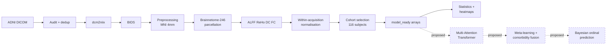

# Comorbidity-Aware Meta-Bayesian Multi-Attention Transformer for Alzheimer's Disease Progression Prediction Using Resting-State fMRI Biomarkers

Final-year project, Department of Computer Science and Engineering,
Sri Sivasubramaniya Nadar College of Engineering.

---

## Implementation status — read this first

| Module | Status |
|---|---|
| 1. Data audit, conversion, BIDS organisation | **complete** |
| 2. Preprocessing pipeline | **complete** — 167 acquisitions |
| 3. Brainnetome-246 features + normalisation | **complete** — 167/167 |
| 4. Clinical / comorbidity cleaning | **complete** — 116/116 MMSE and CDR, 113/116 on everything |
| 5. Statistical analysis + heatmaps | **complete** |
| 6. Multi-Attention Transformer encoder | **architecture implemented, NOT trained** |
| 7. Comorbidity fusion | **proposed — no code** |
| 8. Meta-learning (MAML) | **proposed — no code** |
| 9. Bayesian ordinal head + uncertainty | **proposed — no code** |
| 10. Training / evaluation pipeline | **proposed — no code** |
| 11. Decision-support dashboard | **proposed — no code** |

**No model has been trained. No weights exist. No accuracy, sensitivity,
specificity or AUC is reported anywhere in this repository**, because none
has been computed.

**No statistical result reaches q < 0.05** after multiple-comparison
correction. That is the finding, not an omission.

---

## 1. Overview and motivation

Alzheimer's disease accounts for roughly 60–70% of dementia cases worldwide
and progresses through recognised stages. Structural atrophy appears
comparatively late; **functional** changes measurable with resting-state fMRI
may appear earlier, which motivates studying them as staging markers.

This project builds a verified, auditable pipeline from raw ADNI DICOM to
model-ready features across six ordered stages, and proposes a model that
would combine several functional biomarkers with clinical context while
reporting its own uncertainty.

## 2. Problem statement

Existing work tends to analyse rs-fMRI biomarkers **in isolation**, to omit
**clinical context**, and to emit **overconfident single labels** on
borderline subjects. Progression is frequently treated as unordered
classification, discarding the natural ordering CN → AD.

**Research question** — can a common progression representation be learned
across several functional biomarkers, accounting for comorbidity and
reporting prediction uncertainty?

## 3. Objectives

1. Build a reproducible, auditable rs-fMRI preprocessing and feature pipeline.
2. Extract and validate ALFF, ReHo, degree centrality and functional connectivity on an anatomically defined 246-region atlas.
3. Assemble a clean, leakage-free, subject-level analysis cohort.
4. Characterise the statistical structure of the features across stages.
5. *(proposed)* Learn a biomarker-invariant representation via meta-learning.
6. *(proposed)* Fuse clinical and comorbidity covariates.
7. *(proposed)* Predict ordinal stage with calibrated uncertainty.

Objectives 1–4 are complete. 5–7 are design only.

## 4. Contributions claimed so far

- **An auditable pipeline.** Every acquisition carries provenance with source
  checksums before and after processing; audits recompute checks from the
  files on disk rather than copying from logs.
- **A demonstrated redundancy.** FC_Strength equals DC/245 exactly (max
  difference 6.939 × 10⁻¹⁸, r = 1.000000000000) and was removed from the
  feature set.
- **Measured biomarker complementarity.** The retained biomarkers share only
  **5.7–11.3%** of their variance, which is what makes treating them as
  distinct meta-learning tasks defensible rather than assumed.
- **An honest negative result.** Five independent analyses agree that no
  univariate stage signal survives correction at this sample size.
- **A self-audited analysis.** A false statistical claim made during the work
  was detected, corrected and documented rather than quietly removed
  ([FINAL_STATISTICAL_AUDIT.md](derivatives/INTRA_INTER_CLASS_HEATMAPS/v2_cohort116/FINAL_STATISTICAL_AUDIT.md)).

## 5. Dataset

ADNI resting-state fMRI, **no T1-weighted scans**. 175 raw acquisitions
audited → 2 pre-excluded → 8 failed (TR ≈ 6.02 s, Nyquist below the filter
cutoff) → **167 preprocessed** from 129 subjects.

**Analysis cohort — 116 subjects, 116 acquisitions, one per subject:**

| CN | SMC | EMCI | MCI | LMCI | AD | Total |
|---:|---:|---:|---:|---:|---:|---:|
| 20 | 20 | 20 | **16** | 20 | 20 | **116** |

MCI falls short of 20 because only 16 MCI subjects have valid data. It was
**not** padded with repeat visits.

Details: [docs/DATASET_AND_COHORT.md](docs/DATASET_AND_COHORT.md)

## 6. Architecture and pipeline



Solid = implemented and executed. Dashed = proposed.

## 7. Biomarkers

| Biomarker | Shape | Meaning |
|---|---|---|
| **mALFF** | 246 | how strongly a region fluctuates (0.01–0.10 Hz), ÷ its own mean |
| **mReHo** | 246 | how synchronised a region's voxels are (Kendall's *W*), ÷ its own mean |
| **DC_z** | 246 | net signed connectivity to all other regions, z-scored |
| **FC** | 246×246 | Fisher-z connectivity, signed, unthresholded, diagonal 0 |

**FC_Strength is excluded** — it equals DC/245 exactly.

Details: [docs/FEATURES_AND_STATISTICAL_ANALYSIS.md](docs/FEATURES_AND_STATISTICAL_ANALYSIS.md)

## 8. Model

**Implemented (untrained):** a multi-attention encoder over 246 ROI tokens
with three branches — global, local (caller-supplied neighbourhood mask), and
network (biased by measured FC, with separate learnable scales for positive
and negative connectivity) — combined by a learned per-ROI gate. 24 unit
tests pass; a smoke test on real features gives 196,374 parameters and
correct output shapes.

**Not implemented:** meta-learning, comorbidity fusion, Bayesian ordinal
head, uncertainty, training, evaluation. The `local_mask` input is also not
provided and is deliberately not invented.

Details: [docs/MODEL_ARCHITECTURE.md](docs/MODEL_ARCHITECTURE.md)

## 9. Repository structure

```
atlases/Brainnetome246/     atlas NIfTI + official LUT
BIDS/                       BIDS-organised NIfTI
Comorbidity/                ADNI clinical tables and image exports
pipeline/                   preprocessing (fsfast_production_4mm6mm.py is production)
scripts/
├── data_prep/              conversion, BIDS, cohort selection
├── biomarkers/             parcellation, feature extraction, normalisation
├── clinical/               earlier clinical cleaner (superseded)
├── comorbidity/            clinical + comorbidity join for the 116 cohort
├── audit/                  audits, statistics, figures
├── model/                  transformer architecture + tests
└── setup/                  WSL/FreeSurfer environment, resilient wrappers
derivatives/
├── fsfast/                 preprocessed BOLD, QC, biomarkers, audit tables
├── biomarkers_normalized/  mALFF, mReHo, DC_z, Fisher-z FC
├── phase1_selected_20/     the 116-subject cohort  (see its README)
│   └── comorbidity/        clinical tables, copied alongside the cohort
├── comorbidity_features/   model_clinical_116.csv — cohort row order
├── clinical_cleaned/       earlier clinical build; STALE, 94/116, LMCI blank
├── model_ready/            X_regional, X_fc, y, subjects, splits
└── INTRA_INTER_CLASS_HEATMAPS/v2_cohort116/   statistics + figures
docs/                       this documentation
tools/                      dcm2niix  (gitignored)
_archive/                   superseded outputs and run logs; nothing deleted
```

Row *i* is the same subject in `model_ready/*.npy`,
`comorbidity_features/model_clinical_116.csv` and
`model_ready/splits/split_assignment.csv` — no join needed.

## 10. Environment

Two environments, deliberately: **Windows** for statistics, figures and model
code; **WSL2 Ubuntu** for the neuroimaging stack (FreeSurfer, ANTsPy,
nipype). Several scripts hardcode `/mnt/c/...` and will discover zero inputs
if run from Windows.

```
WSL      nipype 1.12.0 · antspyx 0.6.3 · nibabel 5.4.2 · nilearn 0.14.1
         numpy 2.3.5 · scipy 1.15.3 · templateflow 25.1.2 · FreeSurfer 7.4.1
Windows  python 3.13.3 · numpy 2.2.2 · pandas 2.3.3 · torch 2.11.0+cpu
tools    dcm2niix v1.0.20260724 (use exactly this version)
```

## 11–13. Running the pipeline and reproducing the analyses

Full commands, seeds, expected outputs and recovery procedures:
[docs/REPRODUCIBILITY.md](docs/REPRODUCIBILITY.md)

Quick reproduction of the statistics (Windows, minutes):

```bash
V=derivatives/INTRA_INTER_CLASS_HEATMAPS/v2_cohort116
python scripts/audit/one_vs_rest_checkpointed.py $V --verify-only
python scripts/audit/one_vs_rest_checkpointed.py $V
python scripts/audit/plot_overall_significance.py $V
python scripts/audit/roi_stage_significance.py $V
python scripts/audit/pairwise_stage_statistics.py $V/pairwise
```

Model tests (nothing is trained):

```bash
python -m pytest scripts/model/test_multi_attention_transformer.py -v
python scripts/model/smoke_test_real_data.py
```

## 14. Results and limitations

**Nothing reaches q < 0.05 in any analysis.**

| Analysis | Family | Discoveries |
|---|---|---:|
| Pairwise ROI × 15 | 3,690 per biomarker | **0** |
| Pairwise FC edges | 30,135 per comparison | **0** of 452,025 |
| ROI × stage one-vs-rest | 1,476 per biomarker | **0** |
| Stage-level one-vs-rest | 24 | **0** |

Smallest adjusted q = **0.139** (mReHo at EMCI, raw p = 0.0058).

This does **not** prove no biological difference exists, and it does **not**
mean the features lack predictive information — significance and prediction
are different questions. Effect sizes reach |g| = 1.37; they do not survive
correction for thousands of simultaneous tests at n = 16–20 per stage.

Principal limitations: 116 subjects for six classes; MCI under-represented;
**MMSE and CDR cannot be used as features** — they are inputs to the ADNI
criteria that assign the label, and Global CDR alone scores 0.386 against the
imaging model's 0.307; residual motion correlates with 129/246
ROIs after nuisance regression; one site contributes 40% of AD scans with no
harmonisation applied; the design is cross-sectional, so **no progression
claim is supported**.

[docs/RESULTS_AND_INTERPRETATION.md](docs/RESULTS_AND_INTERPRETATION.md) ·
[docs/LIMITATIONS_AND_FUTURE_WORK.md](docs/LIMITATIONS_AND_FUTURE_WORK.md)

## 15. Ethics and data access

ADNI data is **not redistributable**. This repository holds derived features
and statistics only; raw imaging must be obtained from
<https://adni.loni.usc.edu> under ADNI's Data Use Agreement, which requires
registration and approval.

ADNI participants gave written informed consent and the study was approved by
the institutional review boards of participating sites. Users must follow the
ADNI Data Sharing and Publication Policy, including its acknowledgement
requirements. No re-identification is attempted; identifiers are ADNI's own
pseudonymous codes.

## 16. Future work

Acquire the missing LMCI clinical tables; expand the cohort **by subject**
rather than by scan; derive the local attention mask from the atlas itself;
add motion and site as covariates or harmonise; establish simple baselines
**before** any transformer result; implement subject-grouped nested
cross-validation with training-fold-only scaling; run ablations that isolate
each design claim; report calibration, not only accuracy.

[docs/LIMITATIONS_AND_FUTURE_WORK.md](docs/LIMITATIONS_AND_FUTURE_WORK.md)

## 17. References

Key methods: Fan et al. (2016) Brainnetome atlas; Jack et al. (2008) and
Petersen et al. (2010) ADNI; Zang et al. (2004, 2007) ReHo and ALFF; Zou et
al. (2008) fALFF; Zuo et al. (2012) network centrality; Avants et al. (2008)
SyN registration; Friston et al. (1996) motion regressors; Power et al.
(2012) motion artefact; Benjamini & Hochberg (1995) FDR; Anderson (2001)
PERMANOVA; Vaswani et al. (2017) transformers; Finn et al. (2017) MAML; Gal
& Ghahramani (2016) Bayesian dropout; McCullagh (1980) ordinal regression.

Full citations: [docs/PROJECT_METHODOLOGY.md](docs/PROJECT_METHODOLOGY.md)

---

## Documentation index

| Document | Contents |
|---|---|
| [PROJECT_METHODOLOGY.md](docs/PROJECT_METHODOLOGY.md) | methods, implemented vs proposed |
| [DATA_SELECTION.md](docs/DATA_SELECTION.md) | **the selection diagram** — 175 raw → 116, every exclusion named |
| [DATASET_AND_COHORT.md](docs/DATASET_AND_COHORT.md) | provenance, acquisition inventory, clinical coverage |
| [PREPROCESSING_PIPELINE.md](docs/PREPROCESSING_PIPELINE.md) | exact parameters, QC, diagrams |
| [FEATURES_AND_STATISTICAL_ANALYSIS.md](docs/FEATURES_AND_STATISTICAL_ANALYSIS.md) | definitions, tests, corrections |
| [RESULTS_AND_INTERPRETATION.md](docs/RESULTS_AND_INTERPRETATION.md) | verified results, honest reading |
| [MODEL_ARCHITECTURE.md](docs/MODEL_ARCHITECTURE.md) | implemented encoder, proposed components |
| [REPRODUCIBILITY.md](docs/REPRODUCIBILITY.md) | environment, commands, recovery |
| [LIMITATIONS_AND_FUTURE_WORK.md](docs/LIMITATIONS_AND_FUTURE_WORK.md) | constraints and next steps |

Two further READMEs sit with the data they describe:

| Document | Contents |
|---|---|
| [derivatives/phase1_selected_20/README.md](derivatives/phase1_selected_20/README.md) | the cohort — layout, per-subject contents, coverage |
| [_archive/README.md](_archive/README.md) | what was archived and why; nothing was deleted |

The previous README is preserved as
[_archive/notes/README.v1_backup.md](_archive/notes/README.v1_backup.md).
