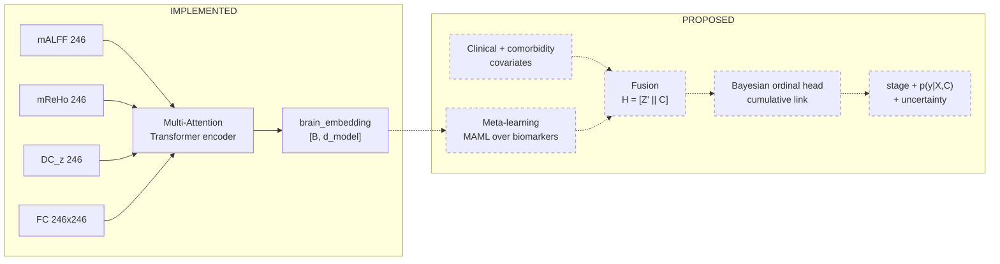

# Model Architecture

**Implementation status, stated first and plainly:**

| Component | Status | Evidence |
|---|---|---|
| Multi-Attention Transformer encoder | **implemented, untrained** | `scripts/model/multi_attention_transformer.py`, 24/24 unit tests pass |
| Three attention branches | **implemented, untrained** | `scripts/model/attention_modules.py` |
| Gated branch fusion | **implemented, untrained** | `BranchFusion` |
| Attention pooling | **implemented, untrained** | `AttentionPooling` |
| Model-ready feature arrays | **implemented** | `derivatives/model_ready/` |
| Local attention mask | **not provided** | required input, deliberately not invented |
| Comorbidity fusion | **proposed only** | no code |
| Meta-learning (MAML) | **proposed only** | no code |
| Bayesian ordinal head | **proposed only** | no code |
| Uncertainty estimation | **proposed only** | no code |
| Training loop / optimiser | **proposed only** | no code |
| Evaluation pipeline | **proposed only** | no code |

**No model has been trained. No weights exist** — a repository-wide search
for `*.pt`, `*.pth`, `*.ckpt`, `*.safetensors` returns nothing. **No accuracy
or any other performance metric exists or is claimed.**

---

## 1. What is implemented

`scripts/model/` — PyTorch 2.11.0+cpu.

```
attention_modules.py              GlobalAttention, LocalAttention,
                                  NetworkAttention, BranchFusion, FeedForward
multi_attention_transformer.py    TransformerConfig, MultiAttentionLayer,
                                  AttentionPooling, MultiAttentionTransformer,
                                  build_model
build_transformer_inputs.py       assembles derivatives/model_ready/
test_multi_attention_transformer.py   24 tests
smoke_test_real_data.py           forward pass on real cohort features
```

### Inputs and outputs (verified by execution)

```python
regional   [B, 246, 3]      mALFF, mReHo, DC_z   (channel order fixed)
fc         [B, 246, 246]    signed Fisher-z
local_mask [246, 246]       caller-supplied; True/1 = edge permitted

returns {
  "roi_embeddings":   [B, 246, d_model],
  "brain_embedding":  [B, d_model],
  "branch_weights":   [B, 246, 3],        order (global, local, network)
  "branch_weights_per_layer": list,
  "pool_weights":     [B, 246] or None,
  "branch_order":     ("global", "local", "network"),
}
```

Smoke test on the real cohort at `d_model=64, num_heads=4, num_layers=2`:
**196,374 parameters**, `roi_embeddings (4, 246, 64)`, `brain_embedding
(4, 64)`, branch weights ≈ (0.30, 0.42, 0.27), pooling weights summing to
1.0, all finite.

### Token construction

Each ROI's three biomarkers are projected to `d_model` and added to a
**learnable ROI identity embedding**:

$$h_i^{(0)} = W_{\text{in}}\,x_i + e_i, \qquad x_i \in \mathbb{R}^3,\; e_i \in \mathbb{R}^{d}$$

The identity embedding is what makes ROI ordering meaningful to the model, so
ROIs must be presented in consistent Brainnetome order 1…246 across every
acquisition. A unit test confirms that permuting ROIs changes the output.

### The three attention branches

**Global** — unrestricted multi-head self-attention:

$$A = \operatorname{softmax}\!\left(\frac{QK^{\top}}{\sqrt{d_h}}\right)$$

Discovers long-range interactions present in neither the neighbourhood mask
nor the measured connectivity.

**Local** — restricted to a caller-supplied mask $M \in \{0,1\}^{246\times246}$:

$$A_{ij} = \frac{\exp(s_{ij})\,M_{ij}}{\sum_k \exp(s_{ik})\,M_{ik}}$$

Disallowed edges are filled with $-\infty$ before the softmax, so they
receive **exactly zero** probability. A row with no permitted neighbour would
make the softmax undefined (`exp(-inf)` everywhere → 0/0 → NaN); such rows
are detected and given an **all-zero** distribution, so the branch
contributes nothing for that ROI and the token survives through the residual
rather than becoming NaN. Three unit tests cover this, including a fully
empty mask.

**Network** — attention biased by the measured connectivity:

$$s_{ij} = \frac{q_i^{\top}k_j}{\sqrt{d_h}} + \alpha^{+}_h\,\mathrm{relu}(C_{ij}) + \alpha^{-}_h\,\mathrm{relu}(-C_{ij})$$

Positive and negative connectivity get **separate per-head learnable
scales**. A single signed bias $\alpha C_{ij}$ would hard-code the assumption
that anti-correlation means *less relevant*; in resting-state fMRI an
anti-correlation is a real relationship, not an absence of one. Both scales
**initialise to zero**, so the branch begins as ordinary self-attention and
any reliance on connectivity is learned rather than assumed. A unit test
confirms that flipping the sign of FC changes the output once the scales are
non-zero.

### Fusion

$$g_i = \operatorname{softmax}\!\big(W[h^{g}_i \,\Vert\, h^{l}_i \,\Vert\, h^{n}_i]\big) \in \Delta^2, \qquad h_i = W_o\sum_{b} g_{i,b}\,h^{b}_i$$

A per-ROI softmax gate, so all three weights are strictly positive — every
branch contributes at every ROI, with relative contributions learned. A unit
test asserts positivity and that the weights sum to 1.

Each layer is pre-norm with two residuals: fused attention, then a
position-wise feed-forward network.

### Pooling

Learnable attention pooling (default) or mean pooling:

$$a_i = \frac{\exp\!\big(w^{\top}\tanh(Vh_i)\big)}{\sum_j \exp\!\big(w^{\top}\tanh(Vh_j)\big)}, \qquad z = \sum_i a_i h_i$$

Documented explicitly because the pooling choice determines which ROIs drive
the whole-brain representation.

### Verification

24 unit tests, all passing in 6.37 s:

- shapes at batch 1, 2, 5; unbatched FC accepted; both pooling modes
- masked edges receive **exactly** zero probability; allowed rows sum to 1;
  a neighbourless ROI yields zeros and finite output; a wider mask changes
  the result
- all three gate weights strictly positive, summing to 1
- FC and its sign change the output once $\alpha \neq 0$
- every parameter receives a finite non-zero gradient, checked per branch
  per layer
- finite outputs with inputs scaled ×1000 and FC ×20
- rejects wrong ROI count, wrong feature count, NaN/Inf, wrong FC shape,
  indivisible `d_model`/`num_heads`
- ROI permutation changes the representation

### The missing input

**`local_mask` is not provided by this repository.** The model takes it as a
caller-supplied argument and no anatomical neighbourhood is invented. The
smoke test uses an all-permitted mask, under which the local branch
degenerates to global attention — adequate for exercising the forward pass,
meaningless scientifically.

A defensible mask would be **derived from the atlas itself** — ROI centroid
distances or true voxel-boundary adjacency computed from
`BN_Atlas_246_2mm.nii.gz` — which is measurement, not assertion. That has not
been done.

---

## 2. What is proposed (no code exists)



### Comorbidity fusion (proposed)

$$H = [\,Z' \,\Vert\, C\,]$$

with $C$ the clinical covariate vector. **A blocking data issue exists**:
within the 116-subject cohort, MMSE, CDR, GDS and medical history are
available for only **94 subjects**, and **LMCI has none at all (0/20)**.
APOE ε4 covers 113/116. Any comorbidity-aware model would currently have to
drop LMCI entirely or acquire the missing ADNI tables. See
[DATASET_AND_COHORT.md](DATASET_AND_COHORT.md) §4.

### Meta-learning (proposed)

Treat each biomarker as a task and learn a biomarker-invariant
representation, e.g. MAML:

$$\theta'_b = \theta - \alpha\nabla_\theta \mathcal{L}^{\text{sup}}_b(\theta), \qquad \theta \leftarrow \theta - \beta\nabla_\theta\sum_b \mathcal{L}^{\text{qry}}_b(\theta'_b)$$

Support and query sets would be **subject-disjoint within training folds**.

Empirical support for treating the biomarkers as distinct tasks: measured
pairwise shared variance is **5.7–11.3%** (mALFF–mReHo 11.3%, mALFF–DC_z
11.1%, mReHo–DC_z 5.7%), so they are 89–94% non-redundant. By contrast
FC_Strength shares 100% with DC and was removed.

### Bayesian ordinal head (proposed)

Cumulative-link model over the six ordered stages:

$$P(y \leq k \mid H, w) = \sigma\!\big(\tau_k - g_w(H)\big), \qquad \tau_0 < \tau_1 < \cdots < \tau_4$$

Ordinal because confusing adjacent stages is a smaller error than confusing
distant ones. Bayesian so borderline subjects receive wide uncertainty rather
than a falsely confident label. Uncertainty would be predictive entropy over
*S* weight samples.

### Training and evaluation (proposed)

Nothing below has been implemented or run.

- **Splitting** — subject-grouped cross-validation. Trivially satisfied here,
  since each subject contributes exactly one acquisition.
- **Scaling** — any cross-subject scaler fitted on **training folds only**.
  The within-acquisition normalisation already applied is leakage-free by
  construction, as it uses no cross-subject statistic and no label.
- **Covariates** — mean FD must be included; 129/246 and 131/246 ROIs still
  correlate with it after nuisance regression. Scanning site should be
  considered given the concentration documented in
  [DATASET_AND_COHORT.md](DATASET_AND_COHORT.md).
- **Loss** — an ordinal loss consistent with the cumulative-link
  formulation.
- **Metrics** — appropriate choices would include mean absolute error in
  stage units, quadratic-weighted kappa, per-class recall, and calibration
  (e.g. expected calibration error). **None has been computed.**
- **Baselines** — a high-capacity model is not justified by the absence of
  univariate significance. It must be compared against simple baselines
  (majority class, logistic/ordinal regression on a few features) before any
  claim of benefit.

---

## 3. Honest appraisal of risk

- **116 subjects, six ordinal classes** — roughly 19 per class. A transformer
  with ~200k parameters at the smoke-test configuration already far exceeds
  the sample size. Overfitting is the dominant risk.
- **No univariate signal survives correction** anywhere in the data
  ([RESULTS_AND_INTERPRETATION.md](RESULTS_AND_INTERPRETATION.md)). That motivates a multivariate approach
  but does not promise one will succeed.
- **The local attention mask does not exist**, so one of the three branches
  cannot currently be used as designed.
- **LMCI lacks clinical data entirely**, so comorbidity fusion cannot be
  evaluated on the full six-stage problem as the data now stands.

These are stated so that a review can assess the proposal on its actual
footing rather than on its ambition.
