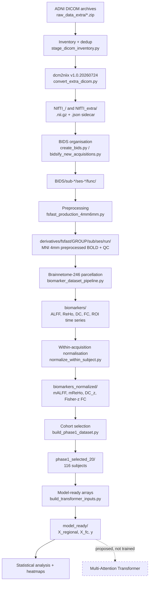
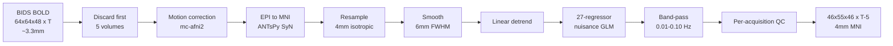

# Preprocessing Pipeline

Documents the pipeline **as implemented**, verified against
`pipeline/fsfast_production_4mm6mm.py` and the per-acquisition JSON
provenance records.

---

## 1. End-to-end flow



Everything from A to Q is **implemented and executed**. R is architecture
only — see [MODEL_ARCHITECTURE.md](MODEL_ARCHITECTURE.md).

---

## 2. Preprocessing steps as implemented



### Frozen parameters

| Step | Tool / parameter | Value |
|---|---|---|
| Volume discard | first N volumes | **5** |
| Slice timing | — | **not performed** (see §3) |
| Motion correction | FreeSurfer FS-FAST `mc-afni2` | defaults; `.mcdat` retained |
| Registration | ANTsPy `ants.registration(type_of_transform='SyN')` | **direct EPI → MNI, no T1w** |
| Template | TemplateFlow `MNI152NLin6Asym` | res-02, `desc-brain_T1w` |
| Resampling | `nilearn` continuous resample | **4 mm isotropic** |
| Smoothing | `nilearn.image.smooth_img` | **6 mm FWHM** |
| Detrending | OLS, intercept + linear | temporal mean restored |
| Nuisance regression | masked GLM | **27 regressors** |
| Band-pass | Butterworth + `filtfilt` | **0.01–0.10 Hz** |
| Workers | — | `n_procs = 1` |

Source: `pipeline/fsfast_production_4mm6mm.py`, constants `N_DISCARD = 5`,
`FWHM_MM = 6.0`, `LOW_HZ, HIGH_HZ = 0.01, 0.10`, `TPL_NAME =
"MNI152NLin6Asym"`.

### The 27 nuisance regressors

```
1          intercept
2–25       Friston-24 motion model
             6 rigid-body parameters
             6 temporal derivatives
             6 squared parameters
             6 squared derivatives
26         white-matter signal      (template-level prior)
27         global signal
```

The design is **28 regressors in principle** — the pipeline header describes
Friston-24 + WM + CSF + GS — but **the CSF regressor failed its reliability
gate in every single acquisition**, so all 167 acquisitions carry exactly
27. This uniformity is verified in the provenance
(`nuisance_regression.n_regressors = 27`) and is a dataset characteristic,
not a per-acquisition decision.

WM and CSF priors come from `MNI152NLin2009cAsym` probabilistic segmentations
used at template level (`WM_CSF_MAPPING = "no_transform"`), a fixed
relationship between two published templates rather than a per-subject
computation. This is a direct consequence of having **no T1w image**: no
subject-specific tissue segmentation is possible.

### Why no T1w changes the design

No structural scan exists for any subject. Consequences:

- Registration is **direct EPI → MNI** rather than the usual EPI → T1w → MNI.
- No subject-specific tissue masks, hence template-level WM/CSF priors.
- **CNR is not computable** and is reported as `NOT_RELIABLY_COMPUTABLE`
  for every acquisition — a genuine limitation, not a missing value.

---

## 3. Slice-timing correction policy

**No slice-timing correction is applied to any acquisition.**

This was verified by source inspection: `pipeline/fsfast_production_4mm6mm.py`
contains no `slicetimer`, `3dTshift`, or equivalent operation. The code goes
directly from volume discard to `mc-afni2`.

The rationale is that ADNI's DICOM/BIDS metadata does not reliably recover
slice order for this dataset, and nothing is inferred. The provenance field
records this as `slice_timing_status: NOT_PERFORMED`.

### One documented exception in the *label*, not the data

`sub-007S2394` — the only GE-scanner acquisition — has a sidecar that
**does** contain `SliceTiming`. The pipeline's flag is computed as:

```python
has_st = "SliceTiming" in meta and bool(meta.get("SliceTiming"))
stc_status = "PERFORMED" if has_st else "NOT_PERFORMED"
```

so that acquisition's provenance reads `PERFORMED`. **This is a mislabel.**
The variable records "slice-timing metadata was present", not "correction
was applied", and `stc_status` is never used outside the JSON output. No
correction was applied to it or to any other acquisition.

Cohort-wide: 166 `NOT_PERFORMED`, 1 `PERFORMED` — with identical underlying
processing. Anyone reading that provenance field should treat it as a
metadata-presence flag.

---

## 4. TR / Nyquist compatibility check

Before filtering, the pipeline validates that the configured band is
realisable for the acquisition's TR:

```
Nyquist = 1 / (2 · TR)      requires    Nyquist > HIGH_HZ = 0.10 Hz
```

| TR | Nyquist | 0.01–0.10 Hz band |
|---:|---:|---|
| 3.000 s | 0.1667 Hz | valid |
| 6.022 s | **0.0830 Hz** | **invalid — rejected** |

Eight acquisitions were rejected on this basis, all with TR ≈ 6.02 s and all
from site 002. The pipeline **refused to process them** rather than quietly
narrowing the filter band to make them pass. They are recorded in
`dataset_failures.csv` with the measured TR and Nyquist value.

TR distribution across the 165 originally preprocessed acquisitions:
139 at 3.000 s, 24 at 3.001 s, 1 at 3.004 s, 1 at 2.25 s.

---

## 5. Execution environment and stability measures

Preprocessing runs **inside WSL2 Ubuntu**, not Windows:

```
FREESURFER_HOME   /home/harish/freesurfer
FSFAST_HOME       /home/harish/freesurfer/fsfast
venv              /home/harish/fyp-neuro-env
scratch           /home/harish/fyp_work/fsfast_4mm6mm   (WSL-native disk)
```

Per-acquisition work happens on the **WSL-native filesystem**, with only the
final required outputs copied to the Windows-visible `derivatives/` tree.
This avoids a large-file write truncation observed on DrvFs (`/mnt/c`)
during pilot development — an `[Errno 5] Input/output error` under sustained
small-granularity array I/O.

`n_procs = 1` throughout, per `audit/wsl_stability_report.txt`.

### Resume logic

`validate_acquisition_complete()` re-validates **the actual output files on
disk** before skipping an acquisition — not merely the presence of a
checkpoint entry. A crash mid-run therefore never reprocesses completed work
nor silently accepts a half-written output.

Resilient wrappers in `scripts/setup/` retry through WSL crashes, detect
corrupted Nipype cache pickles (`EOFError: Ran out of input`) and clean them,
and stop for review on genuine Python errors. `retry_mci_additions_4mm6mm.sh`
additionally refuses to start below 900 MB free WSL memory or 2 GB free disk.

---

## 6. Per-acquisition outputs

```
derivatives/fsfast/<GROUP>/<sub>/<ses>/<run>/
├── <sub>_<ses>_task-rest_<run>_desc-preproc_bold.nii.gz   46×55×46×(T−5), 4 mm MNI
├── <sub>_<ses>_task-rest_<run>_desc-preproc_bold.json     full provenance
├── <sub>_<ses>_task-rest_<run>_motion_parameters.mcdat    mc-afni2 output
├── brain_mask.nii.gz
├── design_matrix.txt                                      (T−5) × 27
├── qc/                                                    metrics and plots
└── biomarkers/                                            23 files, added later
```

### Quality control

Computed per acquisition: tSNR, SNR, CNR (not computable), mean FD, mean
DVARS, GCOR, spatial entropy, temporal entropy. Written to `qc_metrics.csv`,
`qc_metrics.txt`, `qc_report.md`, with FD/DVARS plots.

Status is `PASS` or `WARN`; **`WARN` is the norm** — 156 of 167 acquisitions
carry it, usually for head motion. Acquisitions are **flagged, never
auto-excluded**, so motion must be handled as a covariate downstream.

Cohort QC summary (n = 164, excluding one artefact acquisition
`sub-018S4313` whose tSNR of 322,315 is ~2,500× the median):

| Metric | Median |
|---|---:|
| tSNR | 127.95 |
| SNR | 13.12 |
| Mean FD | 0.317 mm |

---

## 7. Known limitations

- **No T1w** → direct EPI→MNI registration, template-level tissue priors,
  CNR not computable.
- **No slice-timing correction** for any acquisition; one provenance field
  mislabels metadata presence as correction (§3).
- **CSF regressor absent** in all 167 acquisitions — 27 regressors, not 28.
- **8 acquisitions unusable** at the configured band-pass; recoverable only
  by changing the filter, which would break comparability.
- **No cross-site harmonisation.** 14 sites, unevenly distributed.
- **Protocol mixing**: 140-volume and 200-volume acquisitions coexist in the
  cohort. All share TR ≈ 3 s, so the filter is valid for all, but scan
  length differs and affects estimator precision for FC and ReHo.
- **Residual motion in the features**: after the 27-regressor design,
  129/246 (mALFF) and 131/246 (mReHo) ROIs still correlate with mean FD at
  p < 0.05, against ~12 expected by chance. Motion is not fully removed.
