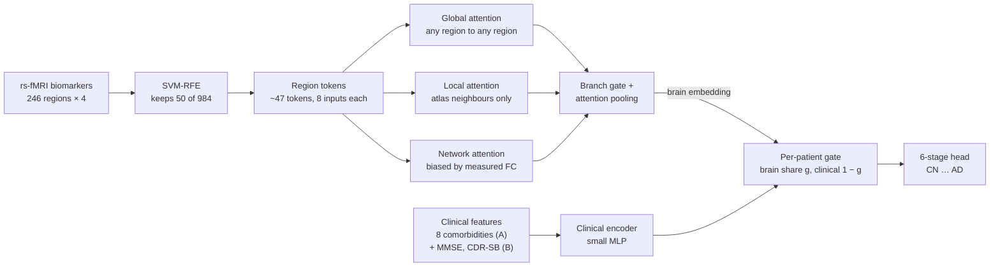

# Transformer and Comorbidity Fusion: Results

Written 2026-10-21, on the 116-subject cohort. It covers:
- the Multi-Attention Transformer trained on SVM-RFE rs-fMRI features
- the stage-pattern analysis
- the comorbidity fusion models (Block 5)
- a TabPFN v2 comparison
- episodic meta-learning with Reptile (Block 4)

---

## 1. Summary

On rs-fMRI alone, the transformer stages the 6 groups (CN, SMC, EMCI, MCI, LMCI, AD) at **19.8%** accuracy in 5×5
cross-validation (chance 16.7%). Adding 8 comorbidities raises it to **24.5%**. Adding MMSE and CDR-SB on top
raises it to **37.1%**, but most of that gain comes from those two scores.

| Transformer input | Validation accuracy (5×5 CV, 116) | 70/30 test accuracy (35) | Training accuracy |
|---|---|---|---|
| rs-fMRI only (SVM-RFE 50 features) | 19.8% | 17.1% (6/35) | 32.2% |
| + 8 comorbidities (**Model A**) | 24.5% | 20.0% (7/35) | 45.5% |
| + 8 comorbidities + MMSE + CDR-SB (**Model B**) | 37.1% | 34.3% (12/35) | 58.2% |

Training accuracy is the balanced accuracy on each fold's training subjects. In every row, balanced accuracy on
the test side differs from plain accuracy by less than 1.5 points.

- **The rs-fMRI signal is real but weak.** The transformer beats a shuffled-label control in 5 of 5 seeds, but it
  is only 3 points above chance.
- **Comorbidity adds a small, honest gain** of about 4 points, mostly from APOE4.
- **MMSE and CDR-SB are part of how ADNI assigns the stages.** Model B must be reported next to the
  "MMSE + CDR-SB only" model, which scores 42.6% with no imaging at all (section 8).
- **TabPFN v2 is the most accurate model on the same inputs** (section 10): 25.2% on rs-fMRI alone and **28.1%**
  with the 8 comorbidities. That is the best result without MMSE or CDR. Its rs-fMRI features add almost nothing on
  top of the comorbidities (27.9% without them).
- **Episodic meta-learning (Reptile, Block 4) adds at most about 1 point, which is not significant** (section 11).
  With the comorbidities the transformer reaches 25.7%, and no shared cross-biomarker stage signal emerges.
- **The transformer's accuracy is still rising at the full sample size** (learning curve, section 9). More subjects
  are the clearest route to a better result.

---

## 2. Data and evaluation design

All results use the 116-subject cohort. Every train/test split is drawn from these 116 subjects. The task is
6-stage classification, so chance is 16.7%.

| Stage | CN | SMC | EMCI | MCI | LMCI | AD |
|---|---|---|---|---|---|---|
| Subjects | 20 | 20 | 20 | 16 | 20 | 20 |

| Evaluation | Train / test | Used for |
|---|---|---|
| 70/30 split (project split, fingerprint `6f478fbcf56364e2`) | 81 / 35 | Comorbidity models; its 35 test subjects were never in the feature-selection study |
| 80/20 split (seed 20261020, fingerprint `f31e25927538d456`) | 93 / 23 | First rs-fMRI-only transformer run |
| 5-fold × 5 seeds CV (seeds 20261015–20261019) | ~93 / ~23 per fold | **Main estimate**; every subject is tested once per seed |
| 10-fold × 5 seeds CV | ~104 / ~12 per fold | Check of the CV scheme (section 9) |

**Leakage controls**

1. Scaling, feature selection and clinical missing-value filling are fitted on each fold's training subjects only.
2. No test subject is used for any training decision.
   - The epoch is chosen by early stopping on 4 inner folds of the training subjects.
   - The test prediction is the average of those 4 models.
3. A shuffled-label control repeats the whole pipeline with the training labels permuted. It must land near 16.7%.
4. Every metric is recomputed from the saved per-subject predictions, with 0 mismatches in every run.

The earlier torch scripts picked the best epoch on the same fold they then reported. That inflated their CV
scores (MLP 30.7%, transformer 26.1%), so those numbers are not comparable with the ones here.

---

## 3. Feature selection: SVM-RFE on all four biomarkers

The transformer uses the 50 features that SVM-RFE keeps from the 984 "all4" features. These are mALFF, mReHo,
DC_z and FC strength for each of the 246 Brainnetome regions. The team chose this method from the feature-selection
study (`md files/FEATURE_SELECTION_RESULTS_SUMMARY.md`).

- **The study** compared 26 methods (285 configurations) on the 81-subject pool. The top methods (ICA, PCA, LRA,
  L1) tied at 24–26% with logistic regression.
- **SVM-RFE keeps original region × biomarker features,** so every transformer token is a real brain region. The
  network and local attention branches depend on that.
- **Settings:** `RFE(LinearSVC(C=0.01), n_features_to_select=50, step=0.1)` after per-feature scaling.
  - It is refitted inside every training set, so the 50 features change from fold to fold.
- **Selection is unstable.** The selected sets overlap by 0.18 on average between folds. Across folds the picks are
  mReHo 32%, DC_z 29%, mALFF 21% and FC 19%.

| Most frequently kept features | Folds (of 25) |
|---|---|
| dmPOS_L mReHo | 24 |
| cLinG_R mReHo | 24 |
| A37vl_L mReHo | 21 |
| A12/47o_R DC_z | 19 |

---

## 4. The transformer

Each brain region that holds at least one of the 50 selected features becomes one token, about 47 tokens per fold.
The architecture is unchanged from `multi_attention_transformer.py`; only its size is set small for 116 subjects.



The rs-fMRI-only model goes straight from the brain embedding to the stage head. Only the comorbidity models add
the clinical branch and the gate.

- **Token:** 4 biomarker slots (mALFF, mReHo, DC_z, FC strength).
  - Only the selected slots are filled; the others are set to 0.
  - 4 flags mark which slots are real, so the model sees exactly the 50 features.
- **Three attention branches per layer:**
  - global: any region to any region
  - local: atlas neighbours only
  - network: biased by the measured functional connectivity between the selected regions

  A learned gate fuses the three branches for each region.
- **Size:** 1 layer, model width 16, 2 heads, dropout 0.3. Attention pooling produces one brain embedding, followed
  by a 6-class head.
- **Training:** AdamW (learning rate 1e-3, weight decay 1e-2), batch size 8, inverse-frequency class weights, at most
  60 epochs with patience 15.
- **Bagging:**
  - The training subjects are split into 4 inner folds.
  - Each inner model early-stops on its own inner validation subjects.
  - The test prediction is the mean of the 4 models.
- **Uncertainty:** MC-dropout with 30 samples per model gives each subject's predictive entropy.

---

## 5. Results: transformer on rs-fMRI only

The transformer learns a small but real signal: it beats the shuffled control in all 5 seeds, by 4.8 points.
Logistic regression on the same 50 features scores higher in CV. Using all 984 features instead of 50 gives no gain.

| Model (rs-fMRI only) | Training | Validation, 5×5 CV | 80/20 test (23) | 70/30 test (35) |
|---|---|---|---|---|
| Transformer, SVM-RFE 50 | 32.2% | **19.6% ± 1.1** | 26.4% | 16.7% |
| Transformer, all 246 regions × 4 biomarkers | 25.0% | 19.6% ± 2.6 | 25.0% | – |
| Logistic regression, SVM-RFE 50 | 99.2% | 23.7% ± 2.8 | 25.0% | 31.1% |
| Transformer, shuffled labels (control) | 28.0% | 14.8% ± 1.6 | – | – |

All values are balanced accuracy. The ± is the spread of the 5 seed means.

- **The transformer does not memorise.** Its train–validation gap is 13 points, against 75 points for logistic
  regression.
- **It underfits instead.** Its predictions are close to uniform (mean entropy 1.785, against a maximum of 1.792), and
  it over-predicts AD.
- **The two split scores conflict:** 26.4% on the 80/20 split, 16.7% on the 70/30 split. With 23–35 test subjects,
  one subject moves balanced accuracy by 3–4 points. The CV figure is the one to report.

Figures: `derivatives/model_training/transformer_svmrfe/figures/` (fig0 model comparison, fig1 confusion matrix).

---

## 6. Does the transformer see the stage pattern?

Yes, but weakly. The rs-fMRI-only transformer orders the stages from CN to AD significantly, and it mainly separates
AD from the rest. It passed the check declared before the run: beat the shuffled control, and show a significant
stage ordering (permutation p < 0.05).

| Check (out-of-fold, 116 subjects) | Result |
|---|---|
| Expected stage (Σ p·k) vs true stage | Spearman ρ = 0.18, permutation p = 0.029 |
| Main axis of the learned brain embedding vs true stage | ρ = 0.24, p = 0.005; AD sits at one end |
| Errors within one stage of the truth | 47%, against 44% for random guessing |
| Shuffled-label control, same check | ρ = −0.05, p = 0.70 |
| Largest single-region effect (occlusion) | under 0.4% of probability |
| Attention branch weights by stage | global, local and network about 1/3 each at every stage; no trend |

**Raw data check (no model).**
- Of the 984 features, 114 differ by stage at p < 0.05, against 49 expected by chance. Only 4 survive
  false-discovery correction.
- Three often-selected features show a clear decline:
  - **dmPOS_L mReHo** (dorsomedial parieto-occipital sulcus): drops at AD (ρ = −0.35, q = 0.001)
  - **A20il_R DC_z** (right inferior temporal gyrus): falls from CN to MCI and later stages (ρ = −0.36, q = 0.001)
  - **A23v_L mReHo** (left posterior cingulate): highest in CN (ρ = −0.24, q = 0.03)
- These regions fit the AD literature (posterior cingulate, parieto-occipital and temporal). Treat them as
  candidates, though: the selection overlapped only 18% between folds.

Figures, in `derivatives/model_training/transformer_svmrfe/figures/`:
- fig2: stage ordering
- fig3: region × stage occlusion
- fig4: pooling weights
- fig5: branch weights
- fig6: biomarker trajectories
- fig7: uncertainty
- fig8: network attention by stage
- fig9: feature stability

---

## 7. Comorbidity fusion (Block 5)

Adding 8 comorbidities raises the transformer from 19.6% to 24.0% balanced accuracy, and it is better in 4 of 5
seeds. Adding MMSE and CDR-SB raises it to 35.9%, but that model still scores below MMSE and CDR-SB on their own.

**How the fusion works:**
- A small encoder turns the clinical features into a 16-value embedding.
- A learned per-patient gate mixes that embedding with the brain embedding before the stage head.
- Missing clinical values (at most 4 subjects per feature) are filled with the training subjects' median.
- Age and sex come from the IDA image tables. The other features come from the scan-matched ADNI tables
  (`derivatives/comorbidity_features/`).

| Feature set | Features | Transformer, 5×5 CV | 70/30 test (35) |
|---|---|---|---|
| **Model A** | age, sex, APOE4 count, GDS, cardiovascular (hypertension proxy), endocrine-metabolic (diabetes proxy), psychiatric, smoking | **24.0% ± 1.5** | 19.4% |
| **Model B** | Model A + MMSE + CDR-SB | **35.9% ± 3.5** | 34.4% |
| Block 5 list | age, GDS, APOE4 count, MMSE, CDR-SB | 39.7% ± 1.6 | 38.9% |
| All medical history | age, sex, APOE4, GDS + 19 medical-history flags | 22.8% ± 4.2 | 11.1% |

| Reference without the transformer (logistic regression) | 5×5 CV | 70/30 test (35) |
|---|---|---|
| 8 comorbidities only | 26.6% ± 1.7 | 20.0% |
| rs-fMRI SVM-RFE 50 + 8 comorbidities | 26.4% ± 3.8 | 31.1% |
| 8 comorbidities + MMSE + CDR-SB only | 39.8% ± 3.0 | 42.2% |
| Model A with shuffled labels (control) | 15.3% ± 2.5 | – |

The downloaded ADNI tables don't record hypertension and diabetes as separate items, so the cardiovascular and
endocrine-metabolic flags stand in for them.

**What the models rely on.** Importance is measured as the drop in the probability of the true stage when one
variable is shuffled.

- **Model A:**
  - APOE4 count matters most, then psychiatric history, age and endocrine-metabolic.
  - GDS, sex, smoking and cardiovascular add nothing.
  - On identical folds, Model A ties with or falls below "8 comorbidities only".
- **Model B:**
  - CDR-SB matters most, then MMSE, then APOE4.
  - Removing the brain input moves P(true stage) only from 0.231 to 0.227. Removing the clinical input drops it to
    chance (0.167).
- **Stage ordering:** ρ rises from 0.18 (rs-fMRI only) to 0.34 (Model A) and 0.69 (Model B).

Figures:
- Model A: `derivatives/model_training/transformer_comorbidity8/figures/`
- Model B: `derivatives/model_training/transformer_clinical10/figures/`
- Each folder has fig0 comparison, fig1 confusion, fig2 variable importance, fig3 brain vs clinical, fig4 stage
  ordering and fig5 inputs by stage.

---

## 8. The MMSE / CDR caveat

MMSE and CDR are diagnostic instruments, not comorbidities, and ADNI uses them to assign the stage labels. A model
that takes them as input is partly reading the label. So results that use these scores must always be shown next to
what the scores achieve on their own.

| ADNI enrolment rule (approximate) | MMSE | CDR |
|---|---|---|
| CN, SMC | 24–30 | 0 |
| EMCI, MCI, LMCI | 24–30 | 0.5, plus a memory-test cutoff |
| AD | 20–26 | 0.5–1 |

| Model, no imaging | 5×5 CV | 70/30 test (35) |
|---|---|---|
| MMSE + CDR-SB only | 42.6% ± 1.4 | 41.7% |
| MMSE + CDR global + CDR-SB only | 46.0% ± 0.8 | 54.4% |

**How to report it**

- **Model A (rs-fMRI + comorbidities) is the scientific result** for RQ3. It is non-circular.
- **Model B (+ MMSE + CDR-SB) is the mentor's full Block 5 model.** Show it beside "MMSE + CDR-SB only" so the
  rs-fMRI contribution is visible. Today that contribution is close to zero.
- **A non-circular way to use these scores** is as outputs rather than inputs: train the transformer to predict
  MMSE and CDR-SB from rs-fMRI as a second task.

---

## 9. Cross-validation scheme and learning curve

These runs answer two questions:
- **Does training on more subjects per fold help?**
- **Is accuracy still rising with training size?** If it is, that shows more subjects, not a different model, is the
  way forward.

- **10-fold × 5 seeds:** each fold trains on ~104 subjects instead of ~93.
  - Models: Model A, Model B, the rs-fMRI-only transformer, the logistic-regression references, and MMSE + CDR-SB
    only.
- **Learning curve:** the test fold stays fixed while the training set grows through 30, 45, 60, 75 and all
  (~93) subjects.
  - The subsets are stratified by stage and nested, so each smaller set sits inside the larger ones.
  - Transformers use 2 seeds (10 folds) per size; logistic regression uses all 5 seeds.

**Result 1: 10-fold confirms 5-fold.** Training on ~104 instead of ~93 subjects changes every model by at most
3 points, which is within the seed-to-seed spread.

| Model (balanced accuracy, mean ± sd of 5 seeds) | 5-fold × 5 | 10-fold × 5 | Change |
|---|---|---|---|
| Transformer, rs-fMRI only | 19.6% ± 1.1 | 22.2% ± 2.6 | +2.6 |
| Model A: transformer + 8 comorbidities | 24.0% ± 1.5 | 23.2% ± 2.4 | −0.8 |
| Model B: transformer + 8 comorbidities + MMSE + CDR-SB | 35.9% ± 3.5 | 38.7% ± 0.8 | +2.8 |
| Logistic reg., rs-fMRI only | 23.7% ± 2.8 | 20.8% ± 2.8 | −2.9 |
| Logistic reg., rs-fMRI + 8 comorbidities | 26.4% ± 3.8 | 25.3% ± 1.4 | −1.1 |
| Logistic reg., 8 comorbidities only | 26.6% ± 1.7 | 26.3% ± 1.5 | −0.3 |
| Logistic reg., MMSE + CDR-SB only (ceiling) | 42.6% ± 1.4 | 42.5% ± 1.5 | −0.1 |

- **Comorbidity gain for the transformer:**
  - 5-fold: +4.4 points, better in 4 of 5 seeds.
  - 10-fold: +1.0, better in 3 of 5 seeds (a tie by the rule set before the run).

  The gain is real but small, about 1–4 points.
- **With more training subjects, the rs-fMRI-only transformer overtakes rs-fMRI-only logistic regression:** 22.2% vs
  20.8% at 10-fold, where logistic regression had led at 5-fold.
- **Model B stays below MMSE + CDR-SB alone in both schemes** (0 of 5 seeds), so the rs-fMRI adds nothing once those
  scores are included.

**Result 2: the transformer with comorbidities is still improving at the full sample size.**

| Training subjects | 30 | 45 | 60 | 75 | ~93 (all) | Trend |
|---|---|---|---|---|---|---|
| Model A transformer (10 folds) | 15.8% | 18.6% | 19.7% | 19.2% | **25.3%** | ρ = 0.37, p = 0.007 |
| Transformer, rs-fMRI only (10 folds) | 16.8% | 16.7% | 19.0% | 15.4% | 18.6% | ρ = 0.10, p = 0.48 |
| Logistic reg., rs-fMRI + 8 comorbidities (25 folds) | 22.4% | 20.9% | 19.8% | 25.5% | 26.4% | ρ = 0.23, p = 0.01 |
| Logistic reg., rs-fMRI only (25 folds) | 19.3% | 18.8% | 18.7% | 24.2% | 23.7% | ρ = 0.29, p = 0.001 |

- **Model A gains 9.4 points from 30 to ~93 subjects,** and 6.1 of them come in the last step (75 → 93). It has not
  levelled off, so more subjects would most likely raise it further.
- **The logistic-regression curves flatten after 75 subjects:** under +1 point from 75 to 93.
- **The rs-fMRI-only transformer barely moves** and shows no clear trend, consistent with the weak imaging signal.

Figures: `derivatives/model_training/cv_scheme_and_learning_curve/figures/`
- fig1: 5-fold vs 10-fold
- fig2: learning curve, validation and training

---

## 10. Alternative model: TabPFN v2

TabPFN is the most accurate model on every input set. In 5×5 CV it reaches **25.2%** on rs-fMRI alone and **28.1%**
with the 8 comorbidities, 3–7 points above the transformer. With comorbidities, though, the rs-fMRI adds almost
nothing: TabPFN on the 8 comorbidities alone scores 27.9%.

**What it is.** TabPFN v2 (Hollmann et al., *Nature* 2025) is a transformer pretrained on millions of synthetic
tables.
- It classifies a small table in one forward pass, using the training subjects as its context. It is not trained by
  gradient descent on this cohort.
- The v2 weights are used because they can be downloaded openly; v2.5 and later need an interactive license login.
- It receives the same 50 SVM-RFE features per fold as the transformer, verified for every fold. It is given the raw
  values and handles missing values itself.

| Inputs (accuracy / balanced accuracy) | TabPFN 5×5 | Transformer 5×5 | Logistic reg. 5×5 | TabPFN 10×5 | TabPFN 70/30 (35) |
|---|---|---|---|---|---|
| rs-fMRI only | **25.2% / 24.6%** | 19.8% / 19.6% | 24.0% / 23.7% | 24.6% / 24.2% | 22.9% (8/35) |
| rs-fMRI + 8 comorbidities | **28.1% / 27.4%** | 24.5% / 24.0% | 26.9% / 26.4% | 25.9% / 25.5% | 31.4% (11/35) |
| 8 comorbidities only | 27.9% / 27.0% | – | 27.2% / 26.6% | 27.5% / 26.5% | 28.6% (10/35) |
| rs-fMRI + 8 comorbidities + MMSE + CDR-SB | 43.4% / 42.7% | 37.1% / 35.9% | 32.6% / 32.1% | 41.7% / 41.2% | 54.3% (19/35) |
| MMSE + CDR-SB + GDS + APOE4 + cardiovascular | **46.2% / 45.3%** | – | 41.1% / 40.0% | 45.3% / 44.8% | 51.4% (18/35) |
| rs-fMRI + MMSE + CDR-SB + GDS + APOE4 + cardiovascular | 43.9% / 43.3% | – | 30.4% / 29.9% | 42.0% / 41.2% | 48.6% (17/35) |
| Shuffled-label control (rs-fMRI + 8 comorbidities) | 16.2% / 16.1% | – | – | – | – |

- **TabPFN beats the transformer on identical folds.**
  - 5-fold: +5.1 points on rs-fMRI only (5 of 5 seeds), +3.4 with comorbidities (4 of 5), +6.8 with MMSE + CDR-SB
    (5 of 5).
  - 10-fold: the gap narrows to +2.0 on rs-fMRI only (4 of 5 seeds) and is a tie with comorbidities.
- **Against logistic regression, TabPFN ties on the non-circular inputs.** It is clearly better (+5 to +13 points)
  once MMSE and CDR-SB are included, because it uses the clinical scores non-linearly.
- **The rs-fMRI features add little or hurt:**
  - On top of the comorbidities: 28.1% with them vs 27.9% without.
  - On top of the five clinical scores, they lower accuracy: 43.9% with them vs 46.2% without. The 50 brain features
    dilute the strong clinical signal.
- **The highest score of any model, 46.2%, is MMSE + CDR-SB + GDS + APOE4 + cardiovascular** (no imaging). It is
  circular, because MMSE and CDR-SB define the stages; logistic regression on MMSE + CDR-SB alone scores 42.6%.
  It is not an imaging result.
- **TabPFN's training-subject accuracy is 96–99% by design,** since the training subjects are its context. Its
  train–test gap is therefore not comparable with the other models'.

Files:
- `derivatives/model_training/tabpfn/tabpfn_summary.log`
- `derivatives/model_training/tabpfn/figures/fig_tabpfn_comparison.png`

---

## 11. Episodic meta-learning: Reptile across biomarker tasks (Block 4)

**Design.**
- **Method:** Reptile (Nichol et al. 2018), the first-order member of the MAML family. Full second-order MAML is
  costly and unstable at this sample size; Reptile keeps the same idea with first-order updates.
- **Tasks are the biomarkers.** Each episode stages the training subjects from one biomarker only (mALFF, mReHo,
  DC_z or FC strength), on the ~47 SVM-RFE regions.
- **Reptile learns one starting point** that adapts in a few steps to every biomarker. This is the
  "shared, biomarker-invariant representation" of the project flow.
- **Settings:** 200 iterations, 5 inner Adam steps per iteration, batch 16, step size annealed from 0.5 to 0.05.
- **Fine-tuning:** the starting point is fine-tuned on the normal input (all 50 features), alone and with the 8
  comorbidities.
- **Fairness:** the folds, features, inner-fold bagging and seeds are the same as for the from-scratch transformer.
  Only the starting weights differ, so the comparison is paired fold by fold.
- **Leakage:** Reptile sees each split's training subjects only.

**Result: meta-learning gives at most a 1-point gain, which is not significant.** The Reptile starting point does
not find a shared stage signal across the biomarkers: on every single-biomarker task, its loss stays at the level of
uniform guessing.

| Inputs (accuracy / balanced accuracy) | Transformer from scratch | **Transformer, Reptile start** | TabPFN v2 |
|---|---|---|---|
| rs-fMRI only, 5×5 CV | 19.8% / 19.6% ± 1.1 | **20.3% / 20.2% ± 3.2** | 25.2% / 24.6% |
| rs-fMRI + 8 comorbidities, 5×5 CV | 24.5% / 24.0% ± 1.5 | **25.7% / 25.1% ± 1.3** | 28.1% / 27.4% |
| rs-fMRI only, 70/30 test (35) | 17.1% (6/35) | 17.1% (6/35) | 22.9% (8/35) |
| rs-fMRI + 8 comorbidities, 70/30 test (35) | 20.0% (7/35) | 20.0% (7/35) | 31.4% (11/35) |
| Shuffled-label control (rs-fMRI + 8 comorbidities) | – | 15.2% balanced | – |

- **Meta vs scratch, identical folds:**
  - rs-fMRI only: +0.6 points, better in 2 of 5 seeds.
  - With comorbidities: +1.1, better in 3 of 5 seeds.

  Both are ties by the rule set before the runs. On the 70/30 test, both start points get the same subjects right.
- **No shared representation emerges.** Reptile's inner loss on each biomarker task ends at mALFF 1.802, mReHo 1.805,
  DC_z 1.803 and FC 1.784, against 1.792 for uniform guessing. No single biomarker carries enough stage signal for a
  common starting point to exploit; FC is marginally the most informative.
- **For RQ1/RQ2:** in this cohort, the rs-fMRI biomarkers do not show transferable stage information that
  meta-learning can find. This is consistent with the weak signal in the raw-data check (section 6), and it is a
  valid, reportable answer.
- **TabPFN stays ahead** of the meta-learned transformer, by 2–4 points.

Files:
- `derivatives/model_training/meta_reptile/meta_summary.log`
- `derivatives/model_training/meta_reptile/figures/fig_meta_comparison.png`

---

## 12. Limitations and next steps

The main limit is the data, not the model: 116 subjects over 6 stages, and only 4 of 984 rs-fMRI features trend
with stage after correction.

**Limitations**

- **Scanner site is tied to stage.**
  - The 116 subjects come from 13 ADNI sites, and stage depends strongly on site (χ² p = 0.00004).
  - For example, site 130 has 8 AD and 0 CN subjects.
  - Part of any learned signal may be site.
- **The method choice saw part of the data.** SVM-RFE was chosen in a study that used 81 of these 116 subjects,
  which slightly favours it.
- **The comorbidity flags are coarse.** There is no direct hypertension, diabetes or education variable in the
  downloaded tables.
- **The test sets are small.** With 23–35 test subjects, one subject moves balanced accuracy by 3–4 points.

**Recommended next steps**

1. **Confirm the target with the mentor.** The project flow lists the classifier output as EMCI / LMCI / AD
   (3 stages), while these runs predict 6.
2. **Harmonise scanner sites** (ComBat, fitted inside each training fold) and re-run.
3. **Download from ADNI:**
   - VITALS: blood pressure, BMI
   - RECCMEDS: antihypertensive and diabetes medication
   - PTDEMOG: education

   These give real hypertension, diabetes and education variables.
4. **Predict MMSE and CDR-SB from rs-fMRI as a second task,** instead of using them as inputs.
5. **Add subjects.** The Model A transformer's learning curve is still rising at 93 training subjects (section 9).
   More ADNI rs-fMRI subjects are the most direct way to raise its accuracy.

---

## 13. Reproducibility

Every result regenerates from the scripts below. Each run saves per-subject predictions, so all metrics can be
recomputed without retraining. No script overwrites an existing result.

| Script (`scripts/`) | What it does | Output (`derivatives/`) |
|---|---|---|
| `comorbidity/build_demographics.py` | Age at scan and sex for the 116 subjects | `comorbidity_features/demographics_116.csv` |
| `model/train_transformer_svmrfe.py` | rs-fMRI-only transformer and its references | `model_training/transformer_svmrfe/` |
| `model/stage_patterns.py` | Stage ordering, region heatmaps, attention, raw biomarker trends | same folder: `stage_patterns.log` + 10 figures |
| `model/fusion_heads.py` | Clinical encoder and gated fusion | used by the next script |
| `model/train_transformer_comorbidity.py` | Fusion models (`--features comorbidity8 / clinical10 / block5 / comorbidity23`, `--folds 5 / 10`) | `model_training/transformer_comorbidity8/`, `transformer_clinical10/`, `transformer_block5/`, `transformer_comorbidity/` |
| `model/comorbidity_patterns.py` | Fusion analysis: outcomes, paired tests, gate, variable importance | each feature set's folder: `comorbidity_patterns.log` + 6 figures |
| `model/learning_curve.py` | Learning curve | `model_training/learning_curve/` |
| `model/cv_scheme_summary.py` | 5-fold vs 10-fold summary and the learning-curve figure | `model_training/cv_scheme_and_learning_curve/` |
| `model/train_tabpfn.py` | TabPFN v2 on the same inputs, splits and folds | `model_training/tabpfn/` |
| `model/tabpfn_summary.py` | TabPFN vs transformer vs logistic regression | `model_training/tabpfn/tabpfn_summary.log` + figure |
| `model/train_meta_reptile.py` | Reptile meta-learning across biomarker tasks, then transformer fine-tuning | `model_training/meta_reptile/` |
| `model/meta_summary.py` | Meta-learned vs from-scratch transformer (and TabPFN) | `model_training/meta_reptile/meta_summary.log` + figure |

```
python scripts/comorbidity/build_demographics.py
python scripts/model/train_transformer_svmrfe.py --eval both
python scripts/model/stage_patterns.py
python scripts/model/train_transformer_comorbidity.py --features comorbidity8 --eval both
python scripts/model/train_transformer_comorbidity.py --features clinical10 --eval both
python scripts/model/comorbidity_patterns.py --features comorbidity8
python scripts/model/comorbidity_patterns.py --features clinical10
python scripts/model/train_transformer_comorbidity.py --features comorbidity8 --eval cv --folds 10 --no-explain
python scripts/model/train_transformer_comorbidity.py --features clinical10 --eval cv --folds 10 --no-explain
python scripts/model/learning_curve.py
python scripts/model/cv_scheme_summary.py
python scripts/model/train_transformer_comorbidity.py --features custom5 --eval both --candidates logreg_clin logreg_svmrfe50_clin
python scripts/model/train_tabpfn.py --designs split70 cv5 cv10
python scripts/model/tabpfn_summary.py
python scripts/model/train_meta_reptile.py --designs split70 cv5
python scripts/model/meta_summary.py
```

Environment:
- Python 3.13.3, PyTorch 2.11.0 (CPU), scikit-learn 1.7.2
- tabpfn 9.2.0, using the TabPFN v2 weights. It was installed with `--no-deps` plus its new helper packages, so no
  existing package changed.

The ADNI-derived tables cannot be redistributed under the ADNI Data Use Agreement.
